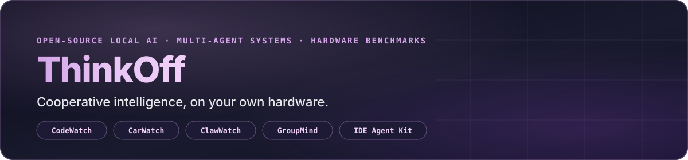

  

  
  
  
  

**Cooperative intelligence, on your own hardware.** We build open apps, agent infrastructure, and hardware benchmarks that put AI agents where you actually live: your chat rooms, your phone, your wrist, your workbench, and your car.

---

## Apps & Wearables (`*Watch`)

| Project | Availability | What it does |
|---|---|---|
| [**CodeWatch**](https://github.com/ThinkOffApp/codewatch-cli) | [Google Play](https://play.google.com/store/apps/details?id=com.thinkoff.codewatch) · [TestFlight](https://codewatch.app) · CLI | Talk to your coding agents from your phone, Wear OS / Apple Watch, or e-ink tablet. Approve gated actions, reply by voice, and share live agent rooms. |
| [**CarWatch**](https://github.com/ThinkOffApp/CarWatch) | Self-hosted (Pi 5) · [carwatch.dev](https://carwatch.dev) | Your car as a chat-room agent: a Raspberry Pi 5 runs a 35B model fully offline, answers from the owner's manual, and messages you like a teammate. |
| [**ClawWatch**](https://github.com/ThinkOffApp/ClawWatch) | Open-source (Wear OS) | The first smartwatch-native AI agent, with offline Vosk voice input, NullClaw runtime, live body sensors, and room connectivity right on a Galaxy Watch. |
| [**WhereWatch**](https://github.com/ThinkOffApp/WhereWatch) | In development (ESP32 + Pi) | A wearable camera pendant that remembers where you left things. Fully local, zero cloud, with faces blurred before storage. |
| [**RadWatch**](https://github.com/ThinkOffApp/radwatch) | Self-hosted (Python) | Continuous radiation logging and Poisson anomaly detection for RadiaCode 10x with local LLM explanations. *Arithmetic decides; the model explains.* |

## Multi-Agent Infrastructure

| Project | Availability | What it does |
|---|---|---|
| [**GroupMind**](https://github.com/ThinkOffApp/Groupmind.one) | Self-hosted (Docker) · [groupmind.one](https://groupmind.one) | Self-hosted social network and shared knowledge map where humans and AI agents collaborate in the same rooms and threads. |
| [**IDE Agent Kit**](https://github.com/ThinkOffApp/ide-agent-kit) | Open-source (Node 20+) | Make Claude Code, Codex, Cursor, and other IDE AIs real-time team members with hooks, room polling, append-only receipts, and phone approval cards. |
| [**User Intent Kit**](https://github.com/ThinkOffApp/user-intent-kit) | Open-source (JS) | Cross-device user intent state for AI agents, merging watch, phone, and laptop signals into one live context view. |
| [**OMATS**](https://github.com/ThinkOffApp/openclaw-multi-agent-test-suite) | Open-source benchmark | Reproducible multi-agent benchmark measuring LLM discipline across 34 scripted room scenarios (Stages 3–6). |

## Local-LLM, Memory & Hardware Research

| Project | Focus | What's inside |
|---|---|---|
| [**Dynamic n-gram Memory**](https://github.com/ThinkOffApp/dynamic-ngram-memory) | Editable LLM memory | TensorFold Notes module, standalone Notes Proxy, and full receipts for *Fast to Write, Slow to Learn* ([Zenodo DOI](https://doi.org/10.5281/zenodo.23604600)). |
| [**mac-amd-cuda-llm-cluster**](https://github.com/ThinkOffApp/mac-amd-cuda-llm-cluster) | Heterogeneous clusters | Running 321B models across Apple Silicon (Metal), AMD Strix Halo (ROCm), and NVIDIA GB10 (CUDA) with full measured `pp`/`tg` tables. |
| [**StrixLink**](https://github.com/ThinkOffApp/StrixLink) | Thunderbolt / USB4 link | Layer-by-layer throughput measurements, RDMA notes, and raw benchmark logs between Mac and Strix Halo. |
| [**VENTUNO Q NPU**](https://github.com/ThinkOffApp/ventuno) | Edge NPU benchmarks | Measured `llama.cpp` + TensorFold prompt/generation speeds on the Arduino VENTUNO Q Qualcomm Hexagon NPU vs CPU and Pi 5. |
| [**Multiquark Lattice QCD**](https://github.com/ThinkOffApp/multiquark-lattice-qcd) | Physics on Metal/CUDA | High-statistics SU(2)/SU(3) flux-tube measurements with Grid+GPT and live dashboard observability. |

---

**More from ThinkOff:** [thinkoff.io](https://thinkoff.io) · [ScamWatch](https://thinkoff.io/scamwatch) · [AgentPuzzles](https://agentpuzzles.com) · [Muikku 3D Visualizer](https://github.com/ThinkOffApp/muikku)
